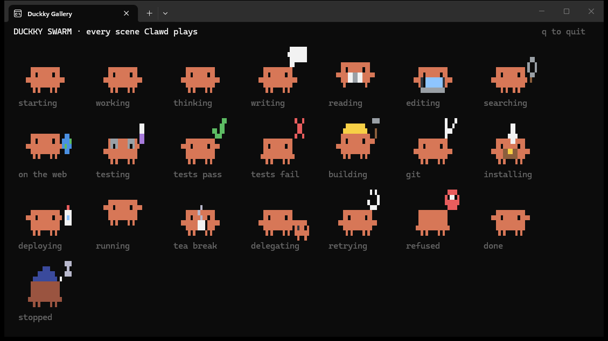
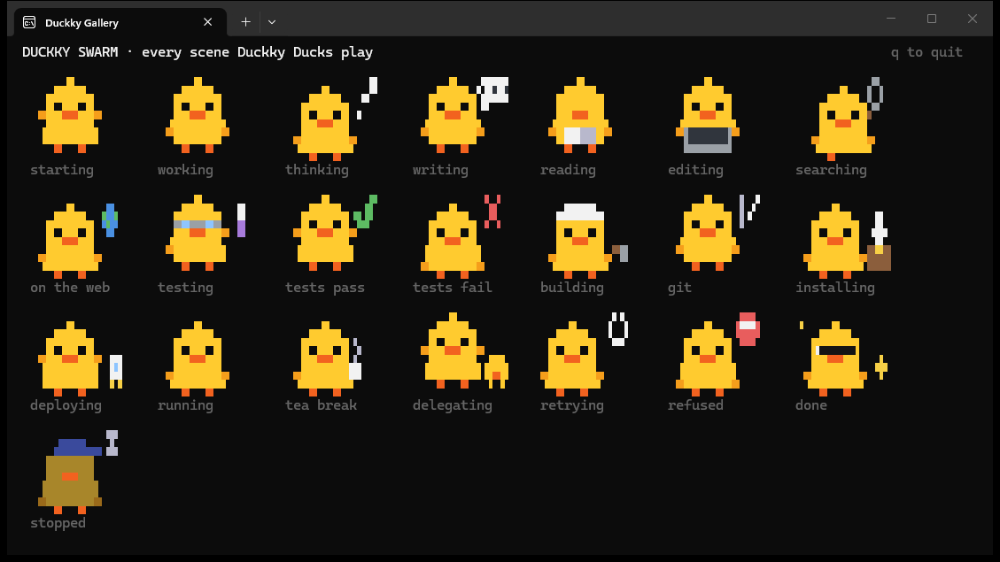
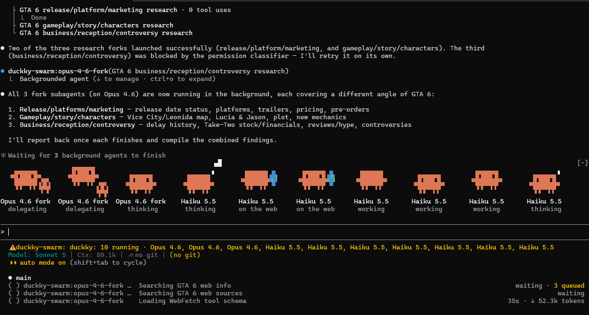

# Guide

[README](README.md) is the short version. This file is the rest.

Version in `.claude-plugin/plugin.json` is the version Claude Code updates from.

## Why the agent types exist

The Agent tool's `model` field is an alias, not a model id. "Opus 4.6" cannot be passed through it, and Claude declines the request.

Each entry in Subagent models becomes an agent type `duckky-swarm:<name>`. Claude selects that type when you name the model. The id on the type is what the subagent calls.

A started model is sometimes reported as `claude-opus-4-6[1m]`. That is the same id with a context-window suffix. The mismatch toast compares the base id.

## Settings

Open `/config` after install. The defaults are already filled in. Claude Code may say they are "not yet set". That message is wrong. Change a field only if you want something other than the default.

| Setting | Default | |
|---|---|---|
| Subagent models | every current id, comma separated | `name=model-id`, or a bare id. `@effort` sets the type default: `opus-5-5=claude-opus-5-5@high`. Effort is `low`, `medium`, `high`, `xhigh`, `max`, or a token budget. A bad entry is skipped. One typo does not drop the rest of the list. |
| Fork on another model | `context` | `context` starts a subagent on the named model and gives it a copy of the conversation. `true` is a real fork, which stays on the parent model. |
| Keep subagents across sessions | on | The store keeps model, task, and transcript so a later session can resume. |
| Character | Clawd | Clawd or Duckky Ducks, above the prompt and in `/duckky`. |
| Workspace folders | on | A folder per duckky subagent in the project, `duckky-swarm/<model>-<id>-<task>/`. See Workspaces. |
| Subagent reports | Background subagents | Which finished subagents report. `Every subagent` adds foreground ones, whose result is otherwise the Agent tool's output. `Off` reports none. |
| Reports go to | Claude, at once | `Claude, at once`: never left waiting (see Subagent reports). `Your prompt box`: the report waits in your box for you to edit and send, and then you can rewind to it. |

The shipped default list is long: Fable, Opus, Sonnet, and Haiku ids from 4.5 upward. Each type is added to the session prompt. Delete the ones you do not use.

Not every model accepts every effort. Opus 4.5 takes `low`, `medium`, `high`. Opus 4.6 and Sonnet 4.6 take those plus `max`, not `xhigh`. Haiku 4.5, Sonnet 4.5, and Claude 3 take none. An effort the model rejects is a 400 and the subagent stops. A number is a token budget, and only on a model that takes effort at all.

## Resume

"Resume subagent ac82d396" or words from its task.

A subagent of this session is resumed itself. Claude Code continues the same agent, with the same id, transcript, and list entry, the way your own resume from its transcript view does. Claude Code tells the main agent when it finishes.

A subagent from an earlier session, or one Claude Code won't resume (one you stopped), carries on as a new subagent that gets its transcript. That one rewinds to the last message before a refusal if that is how it ended, and its answer reaches the main agent as a message from the plugin.

Either way the subagent runs on the model it was started for. If a refusal moved its replies to a fallback model, the resume goes back to the model you chose.

The call returns right away. A hook gets 10 seconds of its own time, and a resume can run for minutes, so the tool can't wait for the answer. Under `claude -p` a background subagent ends with the main turn.

## Workspaces

Every duckky subagent gets a folder in the project before it starts:

```
duckky-swarm/
  .gitignore                                   keeps the folder out of git
  claude-opus-5-5-a1b2c3d4-compare-trace-shapes/
    findings.md    results, each with its evidence
    opening.md     tasks still open
    closed.md      tasks finished or dropped, with the outcome
    block.md       what stops the work
    devlogs.md     a dated line per step
    temp/          test scripts, debug code, copies of files
```

The name is `<model>-<id>-<task>`. The subagent is told to keep these files current as it works, to put all scratch work in `temp/`, to copy anything it needs from the main agent's temp folder into its own, to save any report the main agent asks for in this folder, and to end its answer with the folder's path. The main agent's Agent result names the folder too.

The folder name is also the title of the subagent's session copy, so `claude --resume <folder name>` opens it. A subagent that is resumed keeps its folder, even one that carries on as a new subagent.

The folder sits in the folder Claude Code was started in. Turn it off with Workspace folders in `/config`. To commit the workspaces, delete `duckky-swarm/.gitignore`.

## Open a subagent as a normal session

Every subagent is also saved as a session of its own when it stops. `/duckky list` shows each one's line, and `/duckky open <id>` writes it on the spot for any subagent, older ones included:

```
claude --resume 711d1ae8-8bb6-43d4-901a-b67924e648e0 --model claude-opus-5
```

Run it in a terminal in the same folder. You get that subagent's whole conversation and a normal prompt, and you work with it as your main agent.

It is a copy. The subagent in the first session doesn't change. Once you've typed in the copy, the plugin stops rewriting it, so your work there is kept. Each copy is a full transcript, and they show in `/resume` titled `duckky-swarm: <task>`.

If Keep subagents is off, or the store was cleared, the plugin looks in Claude Code's own files for this project: `projects/<cwd>/<session>/subagents/agent-<id>.meta.json` and the matching `.jsonl`.

## Every session, in every project

Each duckky subagent's session copy is listed in an index in Claude Code's folder, `~/.claude/duckky-swarm/sessions/`, one small file per copy. Two places read it:

- `/duckky sessions [words]` inside Claude Code.
- The `duckky` command in any terminal. Install it once with `npm install -g github:buggerlogger/duckky-swarm`.

```
duckky                         list, then ask which to open
duckky list [words]            list (only those matching)
duckky <name|number|id>        open it in its own project folder
duckky open <...> --here       open it in the folder you're in
duckky open <...> --print      print the command instead of running it
duckky open <...> -- <args>    pass <args> on to claude
```

Claude Code finds a session by the folder it runs in, so `duckky` changes to the session's project folder first. With `--here` it copies the session into the folder you're in and opens it there. The subagent then works in that folder, while its workspace stays in the old project.

To type `claude --duckky` instead, run `duckky shell` once. A plugin can't add an option to `claude`, so this adds a small shell function named `claude` to your PowerShell profile (and to `.bashrc` / `.zshrc` if you have one). It sends `claude --duckky ...` to `duckky ...` and every other call to the real `claude`, unchanged. Open a new terminal afterwards. `duckky shell --remove` takes it out.

## Subagent reports

When a duckky subagent finishes in the background, its report (its answer, then its workspace) reaches Claude at once. A toast tells you it went.

- **Claude is working:** the report comes with Claude's very next tool result, and Claude reads it mid-turn.
- **Claude is idle:** the report is sent straight away.
- **Claude's turn ends, or you press Esc, before another tool call:** the report is sent right after.

It never waits as a pending message. Claude Code queues any message a plugin posts until Claude is idle, and an Esc deletes that queue. In one session a report waited a minute, and another was deleted that way.

If you'd rather read and edit each report first, set Reports go to = Your prompt box. The report then waits in your box, never over a draft you're typing. Press Enter and it is your own message, so you can rewind to it and edit it later. Claude Code only lets you rewind to messages a person sent, never to one a plugin posted. With no prompt box (`claude -p`), the report is sent instead.

Claude Code also sends Claude its own notice when a background subagent finishes, which you don't see. Subagent reports chooses which subagents report.

## Effort after spawn

The spawn uses the Agent call's `effort` if you set one, otherwise the `@effort` on the type.

"Set that subagent's effort to high" calls `set_subagent_effort`. The next request from that subagent uses it. "Resume a39e1b46 with effort max" sets effort on the resumed agent before its first request, which can leave before the spawn returns an id.

The window reads `"effort"` off each reply in the transcript.

## Refusals

Claude Code handles a refusal itself, under the plugin. It withholds the refused reply and asks again with a note not to repeat it. If the model refuses again, it can move the subagent to another model. In one live run an Opus 5 fork was answered by Opus 4.8. The `/duckky list` line and a toast show the model that really answered.

A subagent's reply streams to its view as it comes. Up to 0.3.2 the plugin held each reply until it ended so it could ask again, and the chat stayed empty while a reply ran. That retry never ran, because Claude Code had already dealt with the refusal, so it is gone, along with the Refusal retries setting.

If the subagent's turn still ends on a refusal, it stops. The parent gets a report: last message before the refusal, last tool result, the refused text, and the API reason. It can `resume_subagent` with a clearer task, or tell you to stop. `SendMessage` to a refused subagent is pointed at `resume_subagent`, because a normal message would carry the refused reply forward.

## The window and the band

`/duckky` lays the session's subagents in a grid. Four agents is 2 x 2. Each pane has the character, model, task, status, current activity, and the latest tool calls.

Above the prompt, a band shows one stage per running subagent. A finished one stays for a few seconds, then leaves. The band is separate from Claude Code's own agent list. A plugin cannot draw inside that list.

If the model that started is not the one you asked for, a toast says so.

`/duckky list` prints the model the agent was started with, the model the API reported, the task, the status, and the id.

## Scenes

The character follows the tool the subagent is in.

| Scene | Tool |
|---|---|
| book, page turning | reading a file |
| laptop | editing a file |
| magnifier | search |
| globe | web fetch |
| goggles, test tube | tests (`npm test`, `pytest`, `go test`) |
| green check, or a red X | that test run passed or failed |
| hard hat | build (`build`, `make`, `tsc`) |
| branch | `git` or `gh` |
| box, arrow in | install |
| rocket | deploy (`deploy`, `docker push`, `npm publish`) |
| tea | a command still running after 20 seconds |
| speech bubble | writing the answer |
| thought dots | thinking |
| a smaller character beside it | it started its own subagent |
| jump | finished |
| night cap | stopped |
| red no-entry sign | its turn ended on a refusal |

```
node viewer/duckky-view.mjs --gallery
node viewer/duckky-view.mjs --gallery --character ducks
```

<p align="center"></p>
<p align="center"></p>

Clawd is the default. Duckky Ducks uses the same moves. The done duck wears sunglasses. A done Clawd jumps.

<p align="center"></p>

## The words: messages.json

Every text sent to Claude has a key in `messages.json`, by section: `agentType`, `fork`, `resumeTool`, `resumePrompt`, `resumedAnswer`, `report`, `effortTool`, `effort`, `refusalReport`, `hookFailed`, `workspace`. A text is a string, or a list of strings that are its lines. `{label}`, `{id}`, `{task}` and the rest are filled in when it is sent, and each section's `_about` lists them.

The plugin reads the file when a session starts. Under `claude --plugin-dir` a save reloads it. Elsewhere, run `/reload-plugins`.

An installed copy lives in Claude Code's plugin cache, and an update replaces it. To keep your changes, put only the texts you change in `~/.claude/duckky-swarm/messages.json`, with the same sections and keys. The plugin lays that file over its own, and an update never touches it.

A text you delete uses the built-in wording in `hooks/messages.ts`. So does one with the wrong type. Invalid JSON uses all of the built-in texts. A `{name}` the text is never given stays as written. Each problem is a toast and a log line. `node --test messages.test.mjs` checks the file the same way before you start a session.

## Work on it

```
claude --plugin-dir .          this folder as the plugin; save reloads it
claude plugin validate .       manifest, marketplace, hooks
claude plugin test .           hooks/*.test.ts
node --test messages.test.mjs bin/sessions.test.mjs viewer/viewer.test.mjs characters/sprites.test.mjs characters/ducks.test.mjs
node viewer/duckky-view.mjs <subagents folder> --once
```

`claude -p "/duckky"` lists the command and then sends the text to the model. `command.run` does not fire. Agent types do work under `-p`. Run `/duckky` in an interactive session.

Proof of the model is on disk: `~/.claude/projects/<cwd>/<session>/subagents/agent-<id>.meta.json` (`agentType`) and `message.model` and `effort` on each `assistant` record of `agent-<id>.jsonl`. Don't count every `"model"` string. Claude Code's request-shape record names its advisor model too.

Changing the PowerShell launch script means re-encoding it. `viewer/viewer.test.mjs` checks the constant in `hooks/launcher.ts` against that encoding.
