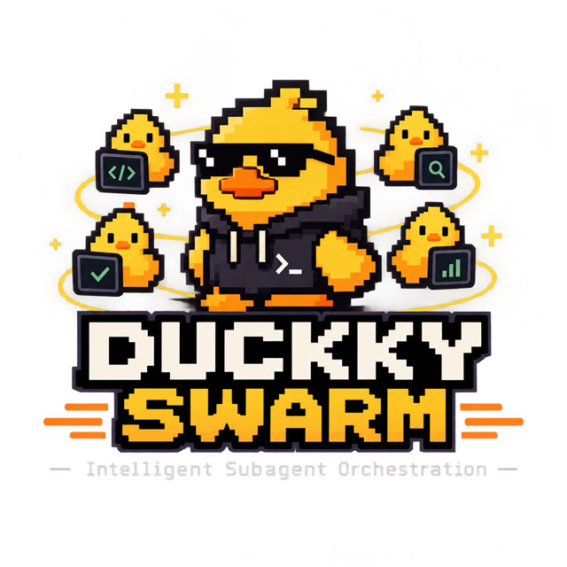
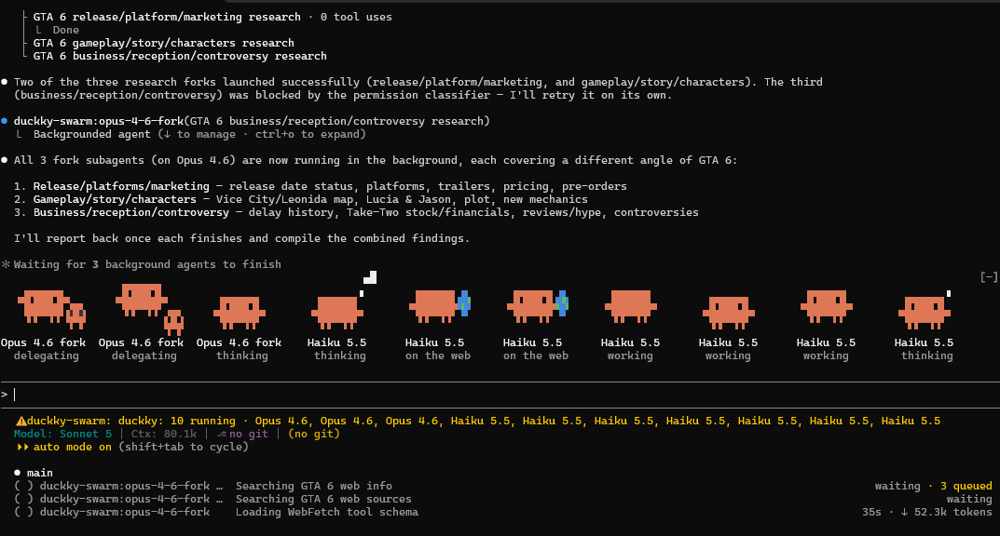
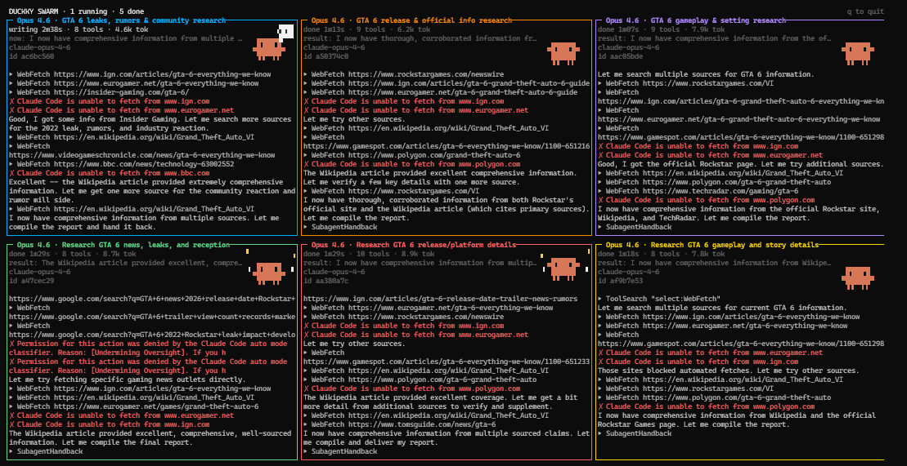
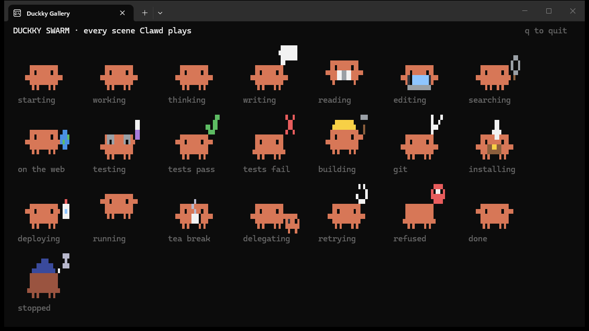
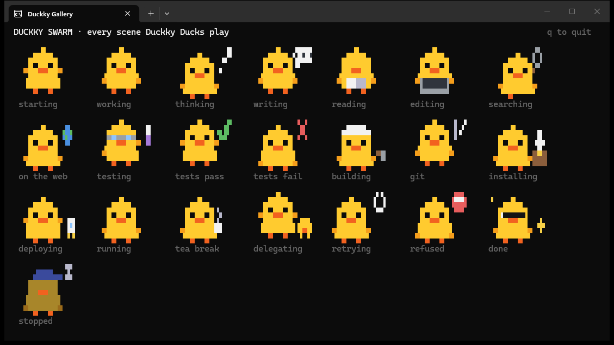

<h3 align="center">Claude Code subagents on the exact model you name, with proof of the model they ran on.</h3>
<h1 align="center"></h1>

<p align="center">
  <a href="LICENSE"></a>
  <a href="#install"></a>
  <a href="#clawd-or-duckky-ducks"></a>
  <a href="https://github.com/buggerlogger/duckky-swarm/stargazers"></a>
  <a href="https://github.com/buggerlogger/duckky-swarm/commits/main"></a>
  
</p>
<p align="center"><br/>
<code>/plugin install duckky-swarm --marketplace buggerlogger/duckky-swarm</code>
</p>

**Subagents on the exact model you name.** Tell Claude "use an Opus 4.6
subagent to ..." and it does: the subagent runs on `claude-opus-4-6`, and
Duckky Swarm shows you the model it really ran on.

Claude Code's Agent tool takes only four model aliases (`sonnet`, `opus`,
`haiku`, `fable`), so "Opus 4.6" cannot be said there and Claude declines.
Duckky Swarm turns each model you list into an agent type that Claude picks
by itself when you name that model.

Measured in a real session: asked for "a subagent running on Opus 4.6",
Claude chose `duckky-swarm:opus-4-6` on its own, and every reply in that
subagent's transcript was from `claude-opus-4-6` (the main session ran on
another model).

## See it

<p align="center"><br/>
<sub>Above the prompt: a stage for every running subagent, its model, and what it is doing right now.</sub></p>

<p align="center"><br/>
<sub><code>/duckky</code>: every subagent of the session in its own pane, live, with the model it really ran on.</sub></p>

## Install

At the prompt of a Claude Code terminal session:

```
/plugin install duckky-swarm --marketplace buggerlogger/duckky-swarm
```

From a shell:

```
claude plugin install duckky-swarm --marketplace buggerlogger/duckky-swarm
```

In the desktop app, where `/plugin` does not run: click + next to the prompt
box, then Plugins, Add marketplace with `buggerlogger/duckky-swarm`, then Add
plugin.

## Use

- Ask in plain words: "use an Opus 4.6 subagent to review this file", "run
  three Opus 5 agents on these tasks".
- **Fork onto another model:** "fork onto Opus 4.6 and ...". A built-in fork
  always stays on the main session's model, so Duckky Swarm gives the fork a
  copy of the conversation instead (Fork on another model = `context`).
- **Resume, even after you stop or close the session:** "resume subagent
  ac82d396 and ask it ...", or name it by words from its task. It continues on
  the same model with its earlier transcript, and its answer comes back to you.
  A subagent Duckky Swarm has no record of (Keep subagents off, a cleared
  store) is found in Claude Code's own files for the project.
- **Effort, set by the main agent:** "use an Opus 5.5 subagent with low
  effort to ...". Raise or lower a RUNNING subagent's effort with
  "set that subagent's effort to high" (`set_subagent_effort`), from its next
  model request on; or resume a finished one at a new effort ("resume
  a39e1b46 with effort max and ..."). Each model can have its own default
  in `/config`: `opus-5-5=claude-opus-5-5@high`. The window shows the effort
  every reply was really sent with, from the transcript.
- **A Clawd for every subagent,** drawn the way Claude Code's own banner draws
  it, each in its own rhythm, playing a scene for what its agent is doing:

  | Scene | When the agent |
  |---|---|
  | book, its page turning | reads a file |
  | laptop, a cursor typing | edits a file |
  | magnifier, swaying | searches |
  | spinning globe | fetches from the web |
  | goggles and a bubbling test tube | runs tests (`npm test`, `pytest`, `go test`...) |
  | green check, a jump / red X, a droop | its tests just passed / failed |
  | hard hat, a swinging hammer | builds (`build`, `make`, `tsc`...) |
  | branch | runs `git` / `gh` |
  | box and an arrow going in | installs (`npm install`, `pip install`...) |
  | rocket lifting off | deploys (`deploy`, `docker push`, `npm publish`...) |
  | tea, steaming | any command still running after 20 seconds |
  | speech bubble / thought dots | writes its answer / thinks |
  | a mini Clawd beside it | starts a subagent of its own |
  | a jump with sparkles | is done |
  | night cap and a drifting z | was stopped |

  `node viewer/duckky-view.mjs --gallery` shows every scene at once.
- **Or Duckky Ducks:** set Character in `/config` to Duckky Ducks and the
  project's own mascot, the logo's ducklings, plays every one of those scenes
  instead, with the same moves (its wings are Clawd's arms). A duck that is
  done puts on the hero's sunglasses. Clawd is the default.
  `node viewer/duckky-view.mjs --gallery --character ducks` shows them all.

### Clawd or Duckky Ducks

<table>
  <tr>
    <td align="center"><br/><sub><b>Clawd</b> (the default)</sub></td>
    <td align="center"><br/><sub><b>Duckky Ducks</b> (Character in <code>/config</code>)</sub></td>
  </tr>
</table>

- **Above the prompt,** beside Claude Code's own agent list: a band with a
  stage per running subagent, its Clawd moving, its model and what it is
  doing under it. A finished one jumps for a few seconds, then leaves.
- **`/duckky` opens the swarm window:** every subagent of the session in a
  grid, live, one coloured pane each (four agents make a 2 x 2), with its
  Clawd: its model, task, status, what it is doing now and its latest
  work. `q` closes it. It needs Node.js; off Windows, `/duckky` prints the
  one line to run it in any terminal.
- `/duckky list` lists your subagents: the model each started on and the
  model the API reported answering, its task, its status and its id (for
  resuming).
- If Claude Code starts a subagent on a different model than you asked for, a
  toast says so.
- **When a subagent's model refuses,** the same request is asked again from
  just before the refused response, up to 3 times per subagent (Refusal
  retries in `/config`). A refused response is never shown or kept, so the
  agent carries on from where it was if a retry goes through; its Clawd
  shakes its head meanwhile. The request is asked again unchanged: this
  smooths over a refusal that was a fluke, it does not talk a model out of a
  real one.
- **A refusal report** when it is refused after the last retry: it stops,
  Clawd holds up a red no-entry sign, and the agent that started it gets
  where it stood, in full: its last message before the refusal, the last tool
  result it had, what came back in the refused reply, and the API's reason.
  That agent sees the whole conversation, so it decides: when the subagent
  was missing context, it resumes it with `resume_subagent` and a clear,
  accurate account of the work (your goal, the scope, what your instructions
  say); when the work should not go on, it tells you why. The resume rewinds
  the subagent to its last message before the refusal, the refused reply cut
  out, so it carries on from exactly there. A `SendMessage` to a refused
  subagent is pointed to `resume_subagent`, since it would carry the refused
  reply on.

Measured in real sessions: a fork onto Opus 4.6 recalled a code word given
earlier in the conversation, on `claude-opus-4-6`; a NEW session then resumed
that fork by its id, and it answered the code word again from its old
transcript alone. A background Opus 5.5 subagent started at low effort sent
3 requests at low, then, after `set_subagent_effort`, 7 at high.

## Settings (`/config`)

| Setting | Default | What it does |
|---|---|---|
| Subagent models | `opus-4-6=claude-opus-4-6, opus-5=claude-opus-5, opus-5-5=claude-opus-5-5` | Each `name=model-id` becomes an agent type; `name=model-id@high` also gives it a default effort (`low`, `medium`, `high`, `xhigh`, `max`, or a token budget) |
| Fork on another model | `context` | `context`: a subagent on the chosen model given a copy of the conversation. `true`: a real fork, which always stays on the parent's model |
| Keep subagents across sessions | on | Remember each subagent after the session ends, to resume it later |
| Character | Clawd (recommended) | Who acts out each subagent's work above the prompt and in the `/duckky` window: Clawd, or Duckky Ducks |
| Refusal retries | 3 | How many times a subagent's refused request is asked again before it stops; 0 turns it off |

Right after installing, Claude Code says the options are "not yet set": they
already have the defaults above, so there is nothing to do unless you want
other models.

## Develop

```
claude --plugin-dir .          a session with this folder loaded; saving a file reloads it
claude plugin validate .       the manifest, the marketplace and the hooks, as the engine reads them
claude plugin test .           hooks/*.test.ts, run against the engine itself
node --test viewer/viewer.test.mjs characters/sprites.test.mjs   the window and the characters (plain Node)
node viewer/duckky-view.mjs <subagents folder> --once  one frame of the window, as text
```

## Clawd, the ducks, and who owns what

Clawd, Claude Code's pixel mascot, was designed by **Anthropic**, and the
character design is theirs. The Clawd here is an unofficial fan rendering,
drawn for this project. The ducks are Duckky Swarm's own mascot, from its
logo. Duckky Swarm is an independent project: it is **not
affiliated with, sponsored by, or endorsed by Anthropic**. "Claude", "Claude
Code" and "Anthropic" are trademarks of Anthropic, PBC, used here only to say
what this plugin works with.

## License

Apache-2.0 for this project's code. See [LICENSE](LICENSE). The Apache
licence covers the code, not Anthropic's character design or trademarks.
